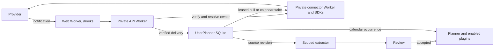

# External connectors for 2do

**Available in the working tree.** Gmail inbox delivery and Google Calendar import and opt-in event publication now have native Google adapters. Connection workers use per-connection Durable Objects for credentials, routing and alarms. The calendar adapter reconciles bounded occurrence pages on notifications and periodically. Email processing ends at a no-op receive hook. [Configuration and current behavior](google-connectors.md)

**Broader V1 design.** A connected calendar supplies commitments directly to Week and Month. A connected inbox supplies evidence from which 2do can suggest tasks and events. Connecting an inbox, choosing which data to interpret, and publishing a particular event are independent decisions. The only V1 provider mutations of user content are explicit calendar sync operations. Replies, drafts, RSVPs, browser actions and general-purpose agent tools belong to V2.

Ship **Google Calendar import** first. It proves a real provider can wake a closed planner and update an open one, with deterministic data that can be checked against the calendar. Follow with Gmail extraction, then opt-in Google Calendar export. Reuse those two paths for Outlook. WhatsApp forwarding exercises a different kind of source, where the webhook itself contains the message.

Keep the interfaces directional. A future Gmail action such as drafting a reply can reuse the account identity, but it needs its own action contract and permissions. In V1 the extractor can propose “reply to Sam by Friday” as a task. Only the user’s calendar sync choice can authorize an external content change.

## What the user gets

| Interaction | Result |
| --- | --- |
| Select a Google calendar, or the primary Outlook calendar | Existing events in the planning horizon appear automatically. A moved appointment keeps its identity. The inspector shows its source and a link when available. |
| Select a Gmail label or Outlook Inbox | A message saying “Submit the form by Tuesday and bring ID on Friday” can produce two independently editable suggestions, each with the wording that supports it. A newsletter can produce zero. Accepting a suggestion creates a normal planner item. |
| Choose **Sync to calendar** on a personal 2do event | Choose one destination and see which fields will sync. Subsequent changes to its title or time in either app converge. **Stop syncing** breaks the link and leaves both copies in place. |
| Pair a WhatsApp sender in Settings | Send or forward a message to the 2do business number. It enters the same extraction and Review flow as email. Personal conversations elsewhere on WhatsApp stay outside this connection. |

## Provider clients and delivery

Use first-party SDKs for provider operations and a maintained protocol client for OAuth. The provider adapter owns pagination quirks, notification validation and conversion to 2do types. Use SDK request options for headers and conditional writes. Keep any protocol operation genuinely missing from the SDK inside its adapter, document the missing method and test it against the provider. An incompatible Node dependency is a reason to try a supported wrapper or run the SDK in a small private Node service.

| Adapter | Implementation choice | Delivery and recovery |
| --- | --- | --- |
| Google Calendar | Official `@googleapis/calendar`. Request `calendar.events.readonly` and `calendar.calendarlist.readonly` for browsing and import. Offer an app-created **2do** secondary calendar as the first export destination with incremental `calendar.app.created` consent. | One expiring watch per selected calendar. Register channel ID and secret before starting the watch, tolerate the initial notification racing the response, then bind the returned resource ID. Check these headers on delivery. Notifications wake incremental sync. Renew with overlap and reconcile on a timer. [Google SDK](https://github.com/googleapis/google-api-nodejs-client) · [Scopes](https://developers.google.com/workspace/calendar/api/auth) · [Watch channels](https://developers.google.com/workspace/calendar/api/guides/push) |
| Gmail | Official `@googleapis/gmail`. Use `gmail.readonly` for body extraction. The label selection is a 2do processing policy within that broader provider grant. | Configure a Google Cloud Pub/Sub topic with Gmail publisher access and an authenticated push subscription. Verify the push OIDC signature, issuer, audience and expected verified service account. Resolve the mailbox reported by the verified subscription against the mailbox recorded during connect. Start the watch before the scoped baseline, then drain changes since its starting history ID. Renew daily. Renewal never advances the committed history cursor. Recover a stale `history.list` cursor (404) with a new scoped baseline. [Push](https://developers.google.com/workspace/gmail/api/guides/push) · [History recovery](https://developers.google.com/workspace/gmail/api/guides/sync) · [Authenticated push](https://docs.cloud.google.com/pubsub/docs/authenticate-push-subscriptions) |
| Outlook Mail and Calendar | Official `@microsoft/microsoft-graph-client` with `@microsoft/microsoft-graph-types` against Graph v1.0. Request delegated `Mail.Read` and/or `Calendars.Read` per feature, offline access for background sync, and `Calendars.ReadWrite` only on export. | Use basic change notifications. Echo the validation challenge promptly. Check subscription ID, resource and secret `clientState` on every entry, including batched deliveries. Renew subscriptions and handle lifecycle notifications. Drain mail delta per selected folder, request immutable Outlook IDs consistently, and persist opaque page/delta URLs. Limit the first calendar release to the primary calendar and a fixed date-range delta per window. [SDK](https://learn.microsoft.com/en-us/graph/sdks/sdk-installation) · [Webhooks](https://learn.microsoft.com/en-us/graph/change-notifications-delivery-webhooks) · [Lifecycle](https://learn.microsoft.com/en-us/graph/change-notifications-lifecycle-events) · [Mail delta](https://learn.microsoft.com/en-us/graph/delta-query-messages) · [Event delta](https://learn.microsoft.com/en-us/graph/api/event-delta?view=graph-rest-1.0) · [Immutable IDs](https://learn.microsoft.com/en-us/graph/outlook-immutable-id) |
| WhatsApp | Twilio Programmable Messaging for WhatsApp and its maintained `twilio` SDK. Start with one registered business receiver and text forwarding. | Generate a short-lived, single-use pairing code in the signed-in planner. The first signed WhatsApp message consumes it and binds the Twilio account, receiver and business-scoped sender (`ExternalUserId` when provided) to that planner. Treat the pairing message as a credential and exclude it from extraction. Use an explicitly verified fallback or re-pair when identities change. Verify the Twilio signature against the configured external URL and all parameters. Deduplicate by account and MessageSid, persist before acknowledging and return an empty messaging response. A delivery-only source exposes gaps it cannot replay. Confirm sender onboarding and applicable terms before a public pilot. [Meta platform](https://developers.facebook.com/documentation/business-messaging/whatsapp/overview/) · [Twilio identities](https://www.twilio.com/docs/whatsapp/key-concepts) · [Signature verification](https://www.twilio.com/docs/usage/webhooks/webhooks-security) · [Platform terms](https://www.whatsapp.com/legal/business-solution-terms/) |

## Nylas evaluation

**Decision, November 25, 2026.** Use the free Nylas sandbox to evaluate Gmail and Outlook intake with synthetic accounts. Keep the native Google Calendar SDK for production export. Defer a paid Nylas commitment until the engineering time saved on mail sync or the value of an earlier public Gmail launch justifies the bill. Google’s native Standard Tier has no API usage charge within its quotas. The direct path still has engineering, hosting and applicable OAuth verification or assessment costs. [Nylas sandbox and production credentials](https://developer.nylas.com/docs/cookbook/use-cases/build/custom-oauth-connector/) · [Google usage tiers](https://developers.google.com/workspace/guides/quota-usage-tiers)

**Pricing in USD.** Free includes five connected email/calendar accounts for testing. Essentials costs $15/month with 10 email-capable accounts and 10 separate calendar-only accounts included. Additional accounts cost $2.25 and $1.70/month respectively. Pro Monthly costs $49/month with 25 and 35 included, then $2.00 and $1.50. Pro Annual starts at $43/month equivalent with the same allowances, then $1.75 and $1.35. The optional preverified Google Shared App requires the $2,400/year Accelerator add-on on Pro Annual, or an Enterprise agreement. The public self-service minimum is **$2,916/year** including the base plan. A production app using its own Google OAuth credentials can use ordinary Connect pricing and handle its own applicable verification. [Nylas price sheet and add-ons](https://www.nylas.com/pricing/) · [Google Shared App](https://developer.nylas.com/docs/provider-guides/google/shared-gcp-app/)

| Billable accounts in one month | Lowest monthly paid plan, own OAuth | Pro Annual, own OAuth | Pro Annual + Google Shared App |
| --- | ---: | ---: | ---: |
| 10 email + calendar | $15.00 | $43.00 | $243.00 |
| 25 email + calendar | $48.75 | $43.00 | $243.00 |
| 100 email + calendar | $199.00 | $174.25 | $374.25 |
| 20 email + calendar and 80 calendar-only | $116.50 | $103.75 | $303.75 |
| 1,000 email + calendar | $1,999.00 | $1,749.25 | $1,949.25 |

These are monthly equivalents at public rates before taxes, 2do infrastructure and inference. Annual columns assume a 12-month commitment. The calculation is the base plus the excess in each account bucket times its rate. One person who links personal Gmail and work Outlook consumes two email-capable accounts. A grant counts for the whole month even if it connects for one day. An invalid grant remains billable until deleted, so deleting the Nylas grant belongs in disconnect cleanup. [Rate and account examples](https://cli.nylas.com/guides/email-api-pricing-models) · [Billing rules](https://developer.nylas.com/docs/support/billing/)

**Fit for 2do.** Read-only Gmail and Outlook each support incoming message notifications through Nylas. Hosted auth and one webhook format can save us a second mail integration, while 2do still owns gap recovery, extraction and deduplication. For Google Calendar export, Nylas lists `calendar.events` or the broader `calendar` for event writes. Its supported scope list omits `calendar.app.created`, the narrower permission for our dedicated 2do calendar. Keep the first write implementation native. During the sandbox trial, test both providers delivering new mail, recovery after a missed notification and the Node SDK in workerd. SDK compatibility and live recovery remain unverified. [Nylas scope matrix](https://developer.nylas.com/docs/dev-guide/scopes/) · [Webhook recovery](https://developer.nylas.com/docs/v3/notifications/) · [Google calendar scopes](https://developers.google.com/workspace/calendar/api/auth)

For a larger catalog of SaaS products, also evaluate Nango as an OAuth broker. If selected, store its connection reference and let it manage token refresh. Keep source scoping, cursor recovery, planner decisions and calendar ownership in 2do. Its Gmail integration still needs push setup for arrival-driven intake. [Nango Auth](https://nango.dev/platform/auth) · [Gmail integration](https://nango.dev/blog/how-to-build-a-gmail-api-integration-with-nango-and-claude)

### Nylas versus the official provider SDKs

**Production choice.** Start the Google Calendar pilot with the official SDK. It gives 2do the dedicated-calendar write scope and tests the source ledger that both paths need. For read-only mail, Nylas is attractive when supporting Gmail and Outlook together saves meaningful engineering time. If the pilot only needs one mailbox provider, build and measure that adapter first. Keep WhatsApp and model inference outside the comparison because both architectures handle them separately.

| Who owns the work? | Native SDKs | Nylas Connect |
| --- | --- | --- |
| Background sync | 2do operates OAuth refresh, Gmail Pub/Sub watches and history recovery, Google Calendar watches and sync tokens, and Graph subscriptions and delta streams. Reuse the existing planner alarm and leased jobs. | Nylas handles provider token refresh and exposes a shared API and webhook format. 2do still handles user reconnection, missed-delivery reconciliation and duplicate deliveries. [Gmail watches](https://developers.google.com/workspace/gmail/api/guides/push) · [Graph lifecycle](https://learn.microsoft.com/en-us/graph/change-notifications-lifecycle-events) · [Nylas webhooks](https://developer.nylas.com/docs/v3/notifications/) |
| Planner behavior | Both paths need account isolation, selected sources, durable receipts, extraction, Review, occurrence identity, conflict resolution, and recovery after a calendar write with an unknown outcome. | Same planner implementation. The connector SDK changes how an observation arrives and how an authorized calendar edit is sent. |
| Public Gmail approval | 2do owns its OAuth registration and applicable annual restricted-scope security assessment for server-side mail processing. Calendar-only rollout avoids the Gmail-specific assessment. | Same verification expense with 2do's OAuth app. With the paid Shared App, Nylas owns the Google verification and CASA assessment for its OAuth project. [Google Gmail scopes](https://developers.google.com/workspace/gmail/api/auth/scopes) · [Annual reassessment](https://support.google.com/cloud/answer/13463816) · [Shared App responsibilities](https://developer.nylas.com/docs/provider-guides/google/shared-gcp-app/) |

**Native cash costs.** Within Standard Tier quotas, Google charges $0 for ordinary Gmail and Calendar API calls. Standard Outlook mail/calendar calls incur no additional Graph API fee within applicable limits for eligible accounts. Native sync therefore adds no provider fee per mailbox. Budget separately for Cloudflare request/CPU time and storage, Gmail Pub/Sub and any assessment. Workers Paid starts at $5/month per Cloudflare account, shared with the existing planner if already subscribed. Pub/Sub includes 10 GiB/month of basic message throughput per billing account, then charges $40/TiB, with transfer and storage priced separately. As an illustration, 1,000 Gmail accounts averaging 20 small notifications/day over 30 days generate 600,000 notifications. At 1 KB each for publishing and delivery, that is roughly 1.2 GB of billed throughput before retries, inside the allowance if unused elsewhere. Total 2do costs depend on actual traffic, CPU, storage and extraction volume. [Google pricing](https://developers.google.com/workspace/guides/quota-pricing) · [Graph metering](https://learn.microsoft.com/en-us/graph/metered-api-overview) · [Metered endpoints](https://learn.microsoft.com/en-us/graph/metered-api-list) · [Workers rates](https://developers.cloudflare.com/workers/platform/pricing/) · [Pub/Sub rates](https://cloud.google.com/pubsub/pricing)

**Build-versus-buy arithmetic.** The table assumes steady billable account counts for a year and the cheapest listed paid Nylas plan for each mix, using 2do's own OAuth app. The third column converts the vendor fee into additional native engineering hours at an illustrative $75/hour, before any difference in infrastructure cost. Count only engineering time that Nylas would actually save, including implementation in year one and ongoing maintenance. [Nylas rates](https://www.nylas.com/pricing/)

| Steady account mix | Nylas fee per year | Equivalent engineering hours per year |
| --- | ---: | ---: |
| 10 email + calendar | $180 | 2.4 |
| 25 email + calendar | $516 | 6.9 |
| 20 email + calendar and 80 calendar-only | $1,245 | 16.6 |
| 100 email + calendar | $2,091 | 27.9 |
| 1,000 email + calendar | $20,991 | 279.9 |

The Gmail assessment affects the Shared App comparison. For example, TAC Security's published 2024 fee sheet quoted $540 for its basic Tier 2 assessment and $4,500 for Tier 3. Google's assigned tier, a current assessor quote and remediation effort determine 2do's cost. At 100 email-capable accounts, the Shared App totals $4,491/year. If a $540 assessment applied, native would have $3,951/year of headroom for extra engineering and infrastructure. With a $4,500 assessment, the shared plan would already cost $9 less before engineering. These are sensitivity examples using historical assessor prices. [Assessor fee sheet](https://tacsecurity.com/wp-content/uploads/2024/12/ESOF-AppSec-ADA-CASA-FAQs-2_compressed-1.pdf) · [Google assessment process](https://support.google.com/cloud/answer/13465431)

## Runtime and storage

1. **Frontend and trust boundary.** The public web Worker currently forwards only `/api`. Access protects `/api` and `/app`. Add exact provider paths under `/hooks/` to web routing and asset precedence. Forward the original request for validation before parsing or rewriting signed fields. Give the private API separate handlers for provider challenges and deliveries. Keep link initiation, OAuth callback, disconnect, review, and calendar publishing under Access. Connector control and credentials are outside the Copilot MCP catalog. [Web routing](../apps/web/src/index.ts) · [Static assets](../apps/web/cloudflare.config.ts) · [Access policy](../infra/access/main.tf) · [API dispatch](../apps/api/src/app.ts)
2. **Credentials and routing.** Put SDKs, OAuth secrets and a small indexed routing/credential store in a private `apps/connectors` Worker reached by service binding. For the native SDK path, use D1 for lookup by subscription, channel, verified mailbox or paired sender and for conditional updates. Bind each grant to the verified planner and stable provider account ID. Generate one-time OAuth state and PKCE with a maintained library, bind state to session, provider, redirect URI and requested features, and verify the returning Access identity. Encrypt refresh tokens at rest under versioned Worker secrets. Serialize refresh and persist rotated tokens. Request Google offline access, retain the existing refresh token when incremental consent returns none and check the actual scopes before enabling a capability. Support multiple accounts per planner. For the pilot enforce one active owner per external mailbox per environment, allow independent grants to the same shared calendar, and never accept a planner ID from a webhook. [Access identity](../apps/api/src/access.ts) · [OAuth client with Workers support](https://github.com/panva/oauth4webapi) · [Google offline access](https://developers.google.com/identity/protocols/oauth2/web-server)
3. **Connection lifecycle.** The planner owns enabled capabilities, resource selections and a generation counter. The connector Worker owns credentials and routing. Record a pending connection before remote setup. Activate only after both stores agree on owner and generation. On disconnect, first disable local work and bump the generation, then retry subscription cleanup and credential revocation or local destruction as supported. Stale callbacks, jobs and OAuth completions cannot reactivate the connection. Reconnecting the same verified account reuses its source identities. Changing the account starts a new namespace. A durable setup/cleanup job resumes after a crash between stores. Recheck generation immediately before dispatch as well as when settling work.
4. **Durable work.** After verification, acknowledge provider notifications only after the owning planner persists a deduplicated receipt and pending job, or stores the normalized message for a delivery-only source. Handle Graph batches per owner and tolerate whole-batch redelivery. Coalesce wakeups per resource using a dirty generation so a notification during a pull causes another drain. Extend `commitTaskWrite`, `nextDue()` and `alarm()` with bounded, fair work for pulls, renewals, extraction, reconciliation and calendar writes. Claim under a lease, perform SDK/model calls outside SQLite transactions, settle only a current lease and grant generation. Observe rate limits, honor Retry-After, back off transient errors, pause revoked grants and show terminal failures in Settings. [Existing planner scheduler](../apps/api/src/user-planner.ts) · [Leased classification](../apps/api/src/core/task-classification.ts) · [Durable Object alarms](https://developers.cloudflare.com/durable-objects/api/alarms/)

| New per-planner records | Invariant |
| --- | --- |
| Connection, resource, watch and checkpoint | Bind a cursor to the provider, stable account, collection and exact query/window. Store next-page continuation and durable progress together. Promote the final cursor only after all observations through it are durable. Restart an invalid baseline in a new generation. Infer absence only after a complete, matching scan. |
| Source item and revision | Key Google calendar events by account, calendar and event ID. Key mail by account and stable message ID, with label/folder membership stored separately. Keep a content digest as well as the provider revision so a read flag cannot retrigger extraction. Store opaque version, change kind, observed/effective times, media type, authorized excerpt/content reference and deep link where available. Use provider ordering or authoritative rereads. Opaque ETags and delivery time cannot order competing versions. Keep a tombstone to prevent resurrection. |
| Extraction, candidate and provenance | One source revision can yield zero to many candidates. A candidate can have several supporting sources. Persist extractor version, evidence spans, normalized fields, confidence and disposition. Reprocessing reuses the accepted result for the same inputs, settings and version. |
| Event link and calendar outbox | Link one local event to its account, calendar, remote ID, occurrence identity and origin. Persist common field snapshot, remote version, last local revision and sync state. Store a stable operation ID, desired fields, expected remote version and grant generation before outbound I/O. The outbox survives local deletion. |

Adapters declare `resourceKinds`, supported ingestion modes (notification plus pull, delivery-only or scheduled pull), and an optional calendar writer. The pull interface returns one page of normalized upserts, removals and opaque continuation/checkpoint. The delivery interface returns verified routes plus wakeups or observations. Only the calendar writer exposes create/update/delete of the small supported event shape. A future SaaS adapter can implement a scheduled pull and reuse the same ledger, Review and settings. Slack, for example, would use its maintained SDK and the Events API scoped to the installed workspace, subscriptions and visible conversations. [Slack Events API](https://docs.slack.dev/apis/events-api/)

## Turning messages into planner items

- Start new mail intake at connection time. Offer an explicit bounded backfill preview. Apply that boundary on initial sync, expired cursors and reconnect. Baselines may index membership without extracting older mail. Enforce selected folders/labels and authorship filters before body processing. Reduce quoted replies, signatures and markup to the relevant text, preserve evidence offsets against the normalized excerpt, and keep provider content out of logs. Default to text. Expose attachment types only when a user enables a handler with an explicit retention policy.
- Record separate permission to send selected content to a model, including for downstream task classification. Use a tool-free, schema-constrained extraction call through the existing AI binding for title, kind, date/time or uncertainty, and supporting quote. A planning agent can interpret ambiguous evidence using only scoped context and return a typed proposal through the same validator. Anchor relative dates to the message date and user/source time zone. Allow abstention and keep ambiguous dates unscheduled. Source text is data and cannot authorize tools, change connector settings or send calendar writes. Plugins can opt into permitted input kinds and fields independently. Record their install version and suppress stale results when disabled.
- Add a `captureCandidate` variant to the existing Review UI/API. Its storage can represent a proposal before any task exists. Support accept, edit-and-accept and dismiss with a revision and idempotency key. Commit the decision, provenance and `Planner.create` in the same transaction. Feed the approved text into the existing enabled-subtype classifier. Preserve manual entries/rejections. For mutable SaaS records, changed evidence supersedes stale pending candidates. A correction email usually has a new message ID. Use thread/reply references and the specific commitment as evidence for an amendment, and retain unrelated proposals in the thread. An accepted task changes only on an explicit amendment decision. An email and its calendar invite may suggest the same commitment. Prefer a reliable provider correlation such as an invitation UID plus occurrence within the same account, and let the user resolve uncertain matches. [Current time-only Review](../apps/api/src/interfaces/review.ts) · [Planner mutations](../apps/api/src/core/planner.ts) · [Plugin flow](plugin-workflows.md) · [Gmail threads](https://developers.google.com/workspace/gmail/api/guides/threads)
- Show the source, quoted evidence and uncertainties in Review and the task inspector. Keep the ledger independent of `task_capture`, which represents a notebook capture on a specific day. Store only the fields needed for the selected feature. Discard full bodies after extracting the bounded evidence excerpt. Give any temporary retry payload a disclosed TTL. **Disconnect** stops new intake and writes. **Remove imported data** also purges payloads, excerpts, candidate evidence and source-only calendar projections for that connection. Preserve user-accepted tasks and local work on linked anchors with the private source details stripped. Neither control deletes provider content. Grant withdrawal must also stop later model reads. Public Gmail rollout needs an eligible use case, scope verification and the applicable restricted-data assessment. Explain the inference processor at connect time, disable content logging, and use synthetic messages for evaluation. [Notebook capture](../apps/api/src/core/notebook.ts) · [Gmail scopes](https://developers.google.com/workspace/gmail/api/auth/scopes) · [Workspace data policy](https://developers.google.com/workspace/workspace-api-user-data-developer-policy) · [Workers AI data handling](https://developers.cloudflare.com/workers-ai/platform/data-usage/)

## Calendar sync rules

1. **Import.** Normalize timed events to fixed intervals and retain the provider time zone. Add an optional exclusive end date to the existing all-day schedule, with a one-day default for saved records. Apply true date arithmetic across daylight-saving changes. Materialize one `kind: event` per occurrence in a bounded planning horizon, initially 30 days back and 90 ahead. Preserve stable IDs across moves and retain any occurrence pinned by a local edit, dependency or notebook reference. Prune source-only projections beyond the horizon and preserve sync identities. Update date search, Week, Month and the inspector together. Use a bounded display title or “Busy” for redacted subjects without ever exporting that placeholder. Carry source visibility and inference permissions into the existing classification hook. Calendar projection requires no model. [Schedule contract](../apps/api/src/interfaces/plan.ts) · [Date search](../apps/api/src/db/planner.ts) · [Calendar projection](../apps/web/client/calendar.ts)
2. **Recurrence and scope.** Let the provider expand occurrences. For Google, keep a calendar-wide master/exception change feed with stable parameters, use separate bounded instance queries to project recurring series, and re-expand on master changes or horizon rollover. Persist series key plus original occurrence start to handle moved exceptions and cancellations. A 410 rebuilds the calendar source index, preserving planner links. For Outlook, save complete Graph next/delta URLs for each fixed window and bootstrap a new overlapping window before retiring the old one. A removal from a view needs reconciliation before declaring the event deleted. Enforce import ownership inside planner mutations, including direct API and Copilot calls. Edit the imported title, time, meeting or series in the provider. Local hiding records a suppression keyed to the source occurrence so the next sync respects it. [Google sync](https://developers.google.com/workspace/calendar/api/guides/sync) · [List parameter restrictions](https://developers.google.com/workspace/calendar/api/v3/reference/events/list) · [Recurring instances](https://developers.google.com/workspace/calendar/api/guides/recurringevents) · [Graph calendar view](https://learn.microsoft.com/en-us/graph/api/event-delta?view=graph-rest-1.0)
3. **Publish.** The signed-in user can opt a scheduled, single-occurrence 2do event into one writable calendar. V1 shares title and schedule (start, end, all-day status and time zone). Keep a linked-only watch or per-ID reconciliation for the destination even when bulk import is off or a published event moves outside the horizon. Microsoft uses the user's own primary calendar initially. Exclude attendees, conferencing, recurrence, descriptions, plugin data and task completion from outgoing patches. If someone adds attendees or converts the remote event to a series, pause writes for that link. A generic task PATCH, notebook delete, Copilot action or plugin cannot create a publishing grant. Carry mutation origin through `Planner` and Review so only user-authorized changes to linked fields can enqueue a write. Unlink cancels queued work, fences in-flight results and explains any action already sent.
4. **Reconcile.** Store the last common snapshot. Compare two independent units to the base, the title and the complete schedule. Never merge the start from one edit with the end from another. Merge independent changes, treat matching normalized updates as echoes, and present overlapping differences in Review with local/remote values and **Keep 2do** or **Use calendar**. Reread and condition every update/delete against the remote version. Google supports `If-Match` and 412. Prove equivalent stale-write rejection on Graph before enabling Outlook patch/delete. Reserve the pending event link and a Google-compatible client-supplied ID or Graph `transactionId` before sending a create. Match incoming changes against pending links within the expected account and calendar before allocating a local occurrence. Prove the Graph correlation is readable on the inbound path or use a supported application-owned event extension. If the result is unknown, look up the original operation before retrying. Pause ambiguous writes for reconciliation. [Google versions](https://developers.google.com/workspace/calendar/api/guides/version-resources) · [Google event IDs](https://developers.google.com/workspace/calendar/api/guides/create-events) · [Google event identity and visibility](https://developers.google.com/workspace/calendar/api/v3/reference/events) · [Graph event identity](https://learn.microsoft.com/en-us/graph/api/resources/event?view=graph-rest-1.0)
5. **Deletion.** A canceled import disappears from the calendar view. Keep a canceled anchor wherever local work depends on it. A remote deletion of a published 2do event unlinks it and leaves the local event available. Offer an explicit **Delete from both** for an eligible published event. Record the tombstone and conditional delete in the same transaction as the local decision, before any FK cascade. Plain local deletion detaches the published copy. Apply these rules at the domain layer across UI, notebook, review and MCP. [Planner delete path](../apps/api/src/core/planner.ts) · [SQLite reference cleanup](../apps/api/src/db/planner.ts)

## Implementation sequence and acceptance

Keep provider capabilities individually switchable. Use authenticated OpenAPI routes for connection setup/status, resource selection, pause/resume, disconnect, candidate decisions and event linking. For example, `POST /api/connections/{id}/authorize` starts consent, `PUT /api/events/{id}/calendar-link` records a publication choice and `DELETE` on that link detaches it. Live connector state belongs to the signed-in planner. Persist only display preferences in the browser.

| Milestone | Code and deliverable | Exit test |
| --- | --- | --- |
| 1. Runtime and provider proof | Validate Nylas mail intake on its free sandbox and record whether it earns the production mail role. Use the native Google SDK for the calendar proof. For the native path add the `apps/connectors` workspace, service binding, D1 schema/migrations, and root package and CI/deploy wiring. Connect one Google test account through Access. Implement the Google watch route, verification/owner lookup, durable wakeup receipt and adapter test harness. Check OAuth exchange/refresh, one SDK list call, webhook verification and bundle size in workerd and on a staging Worker. Start consent-app setup alongside development. | A test user signs in, connects and reconnects the same synthetic account, and receives one real notification. Record exact scopes, platform prerequisites, SDK versions and observed behavior. [Workers Node compatibility](https://developers.cloudflare.com/workers/runtime-apis/nodejs/) |
| 2. Google Calendar import | Add `apps/api/src/interfaces/connectors.ts`, `db/connectors.ts`, `core/connectors.ts`, `routes/connectors.ts`, and forward Drizzle migrations. Extend management routes in `routes/contract.ts`, update `user-planner.ts` and add **Settings → Connections** with selected calendars and health. Implement bounded calendar projection and the schedule extension. | With 2do closed, create, move and cancel an event. Week and Month show the latest state on opening. An already-open view updates using a cheap revision poll while visible and targeted query invalidation. DST, overnight, multi-day and moved recurring exceptions render on the right days. |
| 3. Gmail capture and Review | Implement `apps/connectors/src/google/gmail.ts`, source revisions, extraction jobs, candidate decisions and the Review/inspector UI. Add a separate revision for pending/source changes so a new suggestion refreshes even when the graph revision stays the same. | Replay a delivery, mark the email as read, then send a correction in the same thread. Accept one item, dismiss another and verify the correct amendment and exactly one accepted task with provenance. Repeat with all plugins disabled, one enabled, and two matching independently. Measure missed commitments, false proposals and date corrections on a labeled synthetic set. |
| 4. Google Calendar export | Add event links, durable outbox, write-consent flow and inspector sync controls. Integrate mutation origin and removal in the planner's transaction. | A selected event round-trips once. Deliver the webhook before the create response, then lose the response. Verify one local and one remote event. With bulk import off, move the event beyond the horizon. Test independent and conflicting edits, local metadata, unlink and explicit delete. An unselected event produces zero writes. |
| 5. Outlook | Add `apps/connectors/src/microsoft/` mail and primary-calendar adapters, Graph subscription/lifecycle handlers and permission escalation. Reuse the same UI, extraction and event links. | Test personal and organizational accounts as supported, moved mail across folders, missed wakeup, invalid delta, expired consent and primary calendar import/export. Enable each capability as its recovery and conditional-write tests pass. |
| 6. WhatsApp and extension check | Add `apps/connectors/src/whatsapp/` with Twilio signature validation, pairing and text normalization. Exercise a scheduled-pull test adapter as a stand-in for another SaaS product. | A forwarded WhatsApp message from a paired sender becomes one suggestion. Two planners using the same receiver remain isolated. Unknown senders, replayed pairing codes and duplicate deliveries create no extra inputs. An in-place revision to a pull-only SaaS record amends the right suggestion through the same ledger and Review. |

**Cross-cutting release checks.** Run `npm run openapi`, `npm run openapi:check`, migration generation, workspace tests, typecheck and builds. Cover fresh, populated and legacy planner migrations. Exercise forged and misrouted callbacks, crash between pages, renewal overlap, retry after 429, paused credentials, disconnect during extraction/write, and a sync backlog while classification and plugin effects are due. Test the built web-to-API path and an actual open browser. Track last successful sync per resource, age of oldest queued job, renewal failures, duplicates, conflicts and extraction outcomes, with content-free diagnostics. Settings should distinguish catching up, healthy, reconnect required and failed. Provider round trips and live inference on synthetic data are release evidence to collect during implementation.
