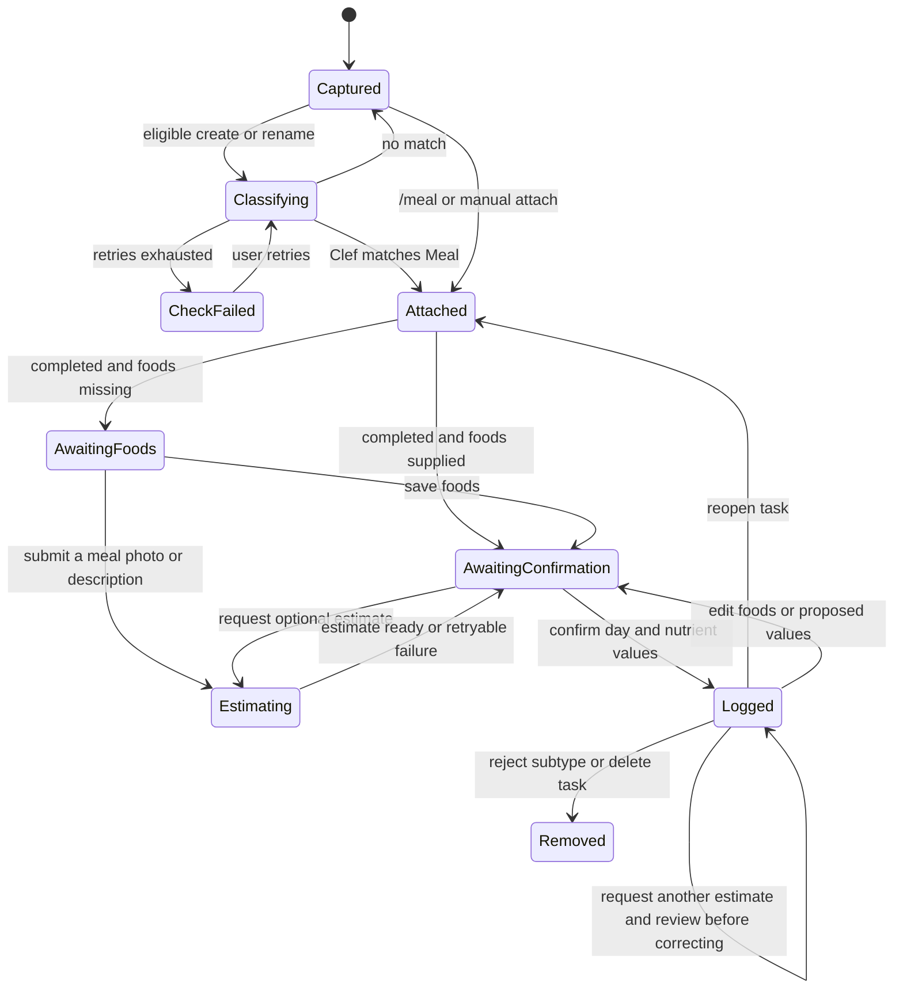

# Stateful plugins, nutrition reports and daily goals

**Implementation status.** The planner implements meal confirmation, corrections, optional nutrient estimates, period reports and daily goals. The design below records the original starting point and implementation sequence. For the shipped interface, working code and commands to add a plugin, use the [agent guide](../apps/api/src/plugins/AGENTS.md).

## Starting point before workflows

1. `Planner.create/update` calls the host inside its SQLite transaction. The installed callback schedules classification on create or title change when a classifier is configured and types are enabled. A notebook capture can supply longer raw input. Explicit typed capture calls `attachAtCapture` in the same page write. [/task and /meal capture](../apps/api/src/core/notebook.ts) · [Host wiring](../apps/api/src/user-planner.ts)
2. `TaskClassification.processDue` claims durable jobs, runs the provider outside the write transaction, then settles under a lease. Clef receives one task per inference context, up to 64 subtype questions per call. Each qualifying match can attach its own initial data. An explicit manual attachment or rejection wins. A receipt records the types actually evaluated and matched. [Classification](../apps/api/src/core/task-classification.ts) · [Clef adapter](../apps/api/src/classifiers/clef.ts)
3. A `nutrition.meal` match initially holds `{}`. Open or complete the task and the summaries module recomputes prompts. A completed meal with missing foods can show “What did you eat?” Saving foods writes the full subtype at its current revision. A skip is stored independently. The meal schema also accepts an optional estimate containing calories and protein grams. [Meal](../apps/api/src/plugins/meal.ts) · [Prompt eligibility](../apps/api/src/interfaces/task-plugins.ts) · [Row summaries](../apps/api/src/core/task-summaries.ts)
4. The original flow ended at the subtype write. Nutrition advertised the versioned `nutrition.logged-meal` fact, with readers and grants supplied by tests. The local-day example looked up scheduled tasks on one page. The new planner report reads all confirmed observations for its period. [Fact resolution](../apps/api/src/core/task-plugins.ts) · [Report queries](../apps/api/src/db/plugin-reports.ts)

## Model one workflow per attached subtype

Classification belongs to the task. Each accepted subtype can then progress independently. A task can be both a meal and an expense, and either workflow may be waiting for input. Keep ordinary prompts as projections of current data. Persist information that cannot be reconstructed, such as the day the user confirmed, an accepted estimate, or an outstanding effect.

The first three entry paths attach the Meal subtype. Subsequent states are derived from the task, its editable subtype, private workflow state and any outstanding effect.

Interpret these as guards on the latest snapshots. If classification arrives after completion, the same reconciliation reaches `AwaitingFoods`. The editor may supply foods before completion. Reopening retracts the active contribution immediately, retains the previous answers as a draft and requires confirmation after completing again. Skipping hides an optional prompt. Disabling suspends actions and hides reports while retaining data. A user can still edit the planner while a plugin is disabled.

### Plugin methods

| Hook | Called by the host | Plugin responsibility |
| --- | --- | --- |
| `describe(current, state, pending, effects)` | On a details read | Return status, available command IDs and defaults. An ordinary field hint uses `prompts`. Core renders commands such as “Confirm meal” from their declared fields. |
| `transition(previous, current, state, event)` | Inside the transaction for a relevant edit or validated command | Pure synchronous decision. Validate domain guards, return the next private plugin state and optional requested effects. The first attachment has no previous snapshot. The host commits state and retracts removed sources. |
| `measure(current, state)` | After a transition, and during a rebuild | Return the complete set of metric observations for this source, with metric ID, stable source key, day and value or unknown. Returning an empty set retracts prior observations. |
| `migrations[fromVersion](payload)` | When upgrading stored data | Convert one known version to the next, deterministically. Validate the result. Version subtype data and private workflow state independently. |
| Optional effect handler | A host worker claims a committed job | Run external I/O with an abort signal and emit a typed success/failure event. A stale result cannot change a newer source. Pure transitions and reads never call an external provider. |

The shipped event union is `changed | resumed | command | effect`. Transitions receive previous/current task and subtype snapshots, the reporting zone and today's civil date. Core retracts projections and removes private state on subtype removal. Foreign keys cascade task deletion to observations, effects, state and command receipts. The report reader evaluates goals using the current time. [Runtime](../apps/api/src/core/plugin-workflows.ts) · [Tables](../apps/api/src/db/schema.ts)

**Ownership.** The meal module decides what “logged” means, whether edited foods invalidate an estimate, and which nutrients a meal contributes. The core runtime owns action dispatch, validation of revisions, transactions, scoped storage, retries and observation replacement. The shared reports module owns grouping, units, coverage and goal comparisons. Hono, MCP and React use the same core commands and query results.

## Implementation order

### 1. Give the host one reliable transition path

- In `interfaces/task-plugins.ts`, add optional action/transition declarations with Zod input and state schemas. Add a `core/plugin-workflows.ts` dispatcher. Persist private state in a planner-local table keyed by `(taskId, typeId)` with schema version and a revision. Keep user-editable subtype fields in the current table. Only the dispatcher writes private state.
- Wire dispatch at the common writes. Cover `Planner.create/update/remove`, explicit capture, `TaskPlugins.write/store`, and classification removing an automatic match. Take the prior snapshot before deletion or cascading foreign keys. Review accept/undo also updates schedules through `Planner.update`. Apply each transition against the effective before/after state in the same outer SQLite transaction. Reconcile from the current snapshot so compound capture and late classification settle correctly.
- Publish available action IDs, input descriptors and expected revisions in task details. Add one generic command endpoint, e.g. `POST /api/tasks/{id}/subtypes/{typeId}/actions/{actionId}`. Authenticate the caller and check the installation. For a new command, validate the installed definition, payload, expected task/subtype/workflow revisions and the current action guard. A manual subtype PUT already replaces the public object. It must invalidate an affected confirmation without allowing callers to forge private state. Store a planner-local receipt with a unique command ID and request digest in the same transaction. For a replay, check the receipt before the revisions that the command itself advanced. Return its original result on identical input, reject reuse with different input.
- Start with synchronous actions. Keep classifier scheduling as-is. Before adding any action that queues an effect, adapt every write path that can schedule one to commit its wake atomically, including subtype PUT, deletion and Review-driven changes. The current host gates its alarm on having a classifier.
- **Done when** a fake two-step plugin progresses via notebook and direct API writes, two subtypes advance independently, completion-before-attach works, stale commands return 409, and failed notebook saves leave zero plugin state, effects or receipts. Delivering the same action twice yields one transition.

### 2. Implement a confirmed meal and its daily total

- Extend `plugins/meal.ts` with the confirm/correct actions. Keep foods and proposed nutrient values editable. Record the accepted snapshot, user-confirmed consumption day, IANA zone and provenance in private state. Support kcal, protein g, carbohydrate g and fat g. A known zero is valid. Represent missing nutrients explicitly. A proposed estimate only becomes countable when the user accepts it. The manual subtype flag also covers empty slash captures and legacy meals.
- Pick one calendar policy for v1. Add a per-planner reporting zone in settings, initialized from the user's IANA zone and persisted on the server. The confirmation form defaults to the task's floating date, or timed start in that zone, or today's local date for an unscheduled task. Show the date and allow backdating. Persist the **confirmed civil day**. A later schedule move, travel, viewer-zone change or midnight alarm leaves it intact. An explicit meal-date correction moves the observation. The zone supplies the default and day-boundary context. Period reports group by the stored day.
- In `interfaces/`, define metric metadata, including namespaced ID, version, label, unit and reducer (start with `sum`). In `db/schema.ts` and a new repository under `db/`, store at most one observation per `(taskId, typeId, sourceKey, metricId)`. Store the day, nullable value, metric version and contributing revision. Index the metric/version and day. For each confirmed meal emit one row per declared nutrient, including unknown values for coverage. Replace that source's entire observation set transactionally. Compute daily totals initially with a grouped query over those rows.
- Route confirm, correction, reopen, rejection and deletion through the same replacement logic. Preserve manual answers and hide work for a disabled installation. On re-enable, reconcile retained state against edits made while disabled before publishing fresh results. Persist an invalidation revision on relevant edits while disabled if a current snapshot alone cannot reveal a reopen/complete cycle. Scope rebuilds to the authenticated planner.
- Add the Drizzle migration, register it in the bundled migrations, and exercise both existing and fresh planners. Old `estimatedNutrition` remains readable as a draft. An older meal has no confirmed consumption day. Offer confirmation before creating an observation.
- **Done when** two completed and confirmed meals of 25 g and 40 g protein total 65 g on Tuesday. Correct 40 to 30 and Tuesday becomes 55. Backdate that second meal to Monday and Tuesday becomes 25, Monday 30. Replay, reopen, reject, delete, disable/edit/re-enable and restart all produce the expected totals. A kcal-only meal leaves protein unknown. Fifty-one meals on a day all contribute.

### 3. Expose daily, weekly and monthly reports

- Add `interfaces/plugin-reports.ts`, `core/plugin-reports.ts`, a batched range query in `db/`, and read-only Hono operations. For example, `GET /api/plugin-metrics/{metricId}/series` takes inclusive `from`, exclusive `to`, and `bucket=day|week|month`. Return the unit, bucket dates, observed sum, number of known observations and number of unknown observations. Return null for a bucket with no known values. A partial sum carries its coverage.
- Build week/month buckets from calendar dates. Pass the planner UI's Sunday/Monday week-start preference explicitly. Use the configured IANA zone for “today” and elapsed days. A month begins on day one. A local day ends at the next local midnight, including the DST transition. Bound the requested range and query all contributing rows for that range directly.
- Expose the metric catalog and render one generic report in the planner. Use the same operation for Copilot if opting it into MCP. Register routes with `routes/contract.ts` and run `npm run openapi`. Keep peer reads separate from planner-owner reports. To expose a report to another plugin, wire a real versioned fact reader with the existing grant checks.
- **Done when** a query spanning a month boundary, a Sunday/Monday week boundary and a DST change produces the expected day keys. Different viewer zones see the same recorded meal day. The same renderer can show protein grams and a fixture's study minutes using only returned metadata.

### 4. Let the core answer “on how many days did I meet this goal?”

- Plugins publish eligible metric definitions and optional goal templates. Add a generic goal editor in Settings populated by the metric catalog. Use `POST /api/goals` to create a user target and a revision-checked update to change or end it from a selected date. Persist a goal ID and effective-dated versions with `metricId`, metric version, unit, daily cadence, comparator (`atLeast`, `atMost`, `between`), threshold(s), active interval and calendar zone. Validate comparable units and nonoverlapping versions.
- Add a goal evaluator over the daily series, then a `GET /api/goals/{id}/history` operation. Enumerate eligible calendar days within the requested interval and effective goal dates. Compare each final daily sum with that day's target, then count days by outcome. A weekly or monthly nutrient sum answers a different question and cannot be used to count daily hits.
- Start with **logged-intake goals**. For an elapsed eligible day, a fully known logged total yields `met` or `missed`. An empty log or any missing value for this metric yields `unknown`. Today's eligible day is `inProgress` with its current sum. Omit future and inactive days from the denominator. This conservative rule makes incomplete logging visible. Counts cover recorded meals. Provide results per goal and per day so the calendar can show which goals were achieved together.
- Return counts alongside the series. Give the calendar a batched history read for all active goals over the visible range, using the same evaluator as single-goal history. Each date carries its goal IDs, outcomes, observed values and targets. For a three-day elapsed window and a user-chosen target of at least 60 g, totals of 65, 55 and no log give **1 met, 1 missed, 1 unknown**. Goal history can report “1 of 3 eligible days” and show the coverage. Correct the first day to 55 and the result becomes **0 met, 2 missed, 1 unknown**.
- **Done when** one generic client shows simultaneous protein and study goals, counts only eligible elapsed days, distinguishes zero from missing, and applies a midweek target change from its effective date. Editing a historical meal revises that day's outcome. Other planners' goal IDs cannot select its data.

### 5. Add asynchronous enrichment when a plugin needs it

- For “Estimate these foods”, have the meal transition enqueue a typed effect. Store a stable effect key, input revision, task identity, installation epoch, attempt and lease deadline with the state change. Put the provider adapter outside the SQLite transaction. Use the per-planner alarm to wake the earliest due classifier or plugin job, including when classification is unconfigured. Reuse the existing claim/settle pattern and its bounded retries.
- Accept a result only for the current lease, installation, schema, task incarnation and foods revision. A stale result is discarded. Show a proposal on success, or allow retry/manual entry on failure. Repeated delivery or a late estimate cannot confirm a meal or overwrite user-entered values.
- **Done when** editing foods during inference, disabling/re-enabling, deleting and recreating the same task ID, losing an alarm wake, and retrying all preserve the user's latest data. Provider failure still permits manual confirmation. [Existing alarm regression scenarios](../apps/api/test/classification-alarm.test.ts)

## Remove repeated work at the source

| Current friction | Concrete fix | Regression check |
| --- | --- | --- |
| The schema and editor independently describe limits and paths. Code for a field kind spans input rendering, serialization, prompts and inlays. Startup checks prompt references and initial data, but a misspelled editor path or out-of-range threshold can still register. | Add a small typed field builder for the two supported primitives that emits Zod fields and editor descriptors. Keep labels, prompts, classification rules and cross-field refinements explicit. Parse the public manifest at registration, verify unique field paths and a finite threshold in [0,1], and exercise a shared field codec for path access/formatting. | A bad path and invalid threshold fail before serving traffic. Zero survives a round trip. Editing an inline field preserves sibling values. |
| Details and batched summaries encode automatic-title visibility and pending/failed state separately. Summary SQL currently lives in core. | Move the common predicates and batched selections into the plugin repository. Preserve the intentional projection difference. Details return null rejections with revisions, while row chips omit them. | Compare details and summaries through rename, recheck, disable, rejection and mixed schema versions. Fetching 64 rows still uses bounded batch queries. |
| Bumping a subtype schema version makes old data opaque to the typed view, prompts and editor. | Register consecutive pure migration functions. Validate every migrated payload, rotate its revision, preserve source/title and rejection tombstones, migrate private state separately, then rebuild observations. Preserve unknown newer versions as opaque. | Seed v1 meal and rejection rows, upgrade twice, then compare details and history. A failed upgrade rolls back. A client holding the old revision receives 409. |
| Route metadata already generates OpenAPI, web types and opted-in MCP tools. New actions could otherwise require glue in all three places. | Keep the catalog as explicit compiled plugin imports. Add one descriptor-driven action form and one generic route. Generate action input descriptors/contract fixtures from supported schema primitives and test the published catalog. Run the existing drift check. | A second fixture plugin contributes an action and a goal with no change to Hono dispatch, the calendar renderer or agent tool definitions. |

The [meal workflow regression](../apps/api/test/meal-workflow.test.ts) exercises the 65 → 55 g correction through the public API. The [effect regression](../apps/api/test/meal-estimation.test.ts) covers delayed, failed and replayed work with a deterministic estimator.
